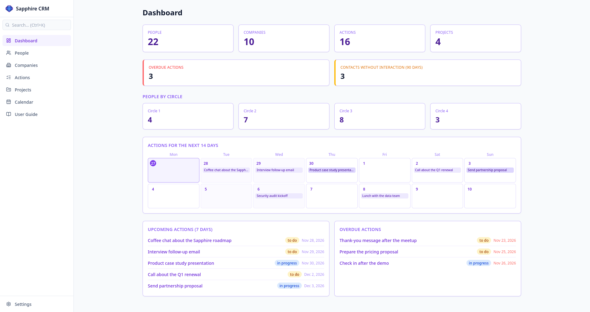

<p align="center">
  
</p>

<h1 align="center">Sapphire</h1>

<p align="center">
  <strong>A free, local-first networking CRM.</strong><br/>
  Your contacts, companies and follow-ups in one place. Your data never leaves your machine.
</p>

<p align="center">
  <a href="https://github.com/KoRIOz675/Sapphire/releases/latest"></a>
  <a href="./LICENSE"></a>
  
  <a href="https://github.com/KoRIOz675/Sapphire/issues"></a>
</p>

<p align="center">
  <a href="https://nbi-project.fr/">Website</a> ·
  <a href="https://github.com/KoRIOz675/Sapphire/releases/latest">Download</a> ·
  <a href="https://github.com/KoRIOz675/Sapphire/issues">Report a bug</a> ·
  <a href="https://github.com/KoRIOz675/Sapphire/issues">Request a feature</a>
</p>

<p align="center">
  
</p>

## Why Sapphire?

Keeping up with your professional network means juggling spreadsheets, sticky notes and email threads. Whether you're growing a client base, searching for your next role, or just staying in touch with the people who matter professionally, Sapphire gives you one structured place for the people you know, the companies you target, every interaction you have, and the campaigns you run. Everything is stored in a local SQLite database: no account, no cloud, no tracking. Sapphire works fully offline; the only network request it can make is an optional update check, off by default.

## Features

- **People:** contacts with role, emails, phone, circle of relation (1-4), manager and referral sources
- **Companies:** sector, size, priority, parent-company relationships
- **Actions:** log calls, meetings and emails with preparation and conclusion notes; list view and Kanban board; native reminders
- **Projects:** group target companies into campaigns, such as a job search or a sales prospecting effort
- **Dashboard and Calendar:** upcoming follow-ups and an 84-day activity chart at a glance
- **Global search:** `Ctrl+K` / `Cmd+K` across everything
- **Notes and attachments:** rich-text notes and local file attachments
- **Data portability:** JSON export/import, CSV import/export, automatic backups
- **Language:** English

## Download

These links always download the [latest release](https://github.com/KoRIOz675/Sapphire/releases/latest):

| Platform | Download |
| --- | --- |
| Windows | [Sapphire.exe](https://github.com/KoRIOz675/Sapphire/releases/latest/download/Sapphire.exe) (installer, recommended) · [Sapphire.msi](https://github.com/KoRIOz675/Sapphire/releases/latest/download/Sapphire.msi) |
| Linux | [Sapphire.AppImage](https://github.com/KoRIOz675/Sapphire/releases/latest/download/Sapphire.AppImage) (any distribution) · [Sapphire.deb](https://github.com/KoRIOz675/Sapphire/releases/latest/download/Sapphire.deb) (Debian / Ubuntu) · [Sapphire.rpm](https://github.com/KoRIOz675/Sapphire/releases/latest/download/Sapphire.rpm) (Fedora) |

### Supported systems

| System | Minimum version | Installer |
| --- | --- | --- |
| Windows | Windows 10 (64-bit) | `Sapphire.exe` or `Sapphire.msi` |
| Ubuntu | 24.04 LTS | `Sapphire.deb` or `Sapphire.AppImage` |
| Debian | 13 (trixie) | `Sapphire.deb` or `Sapphire.AppImage` |
| Fedora | 44 | `Sapphire.rpm` or `Sapphire.AppImage` |
| Other Linux (x64) | glibc 2.39 or later | `Sapphire.AppImage` |

Linux builds need glibc 2.39 or later, so Ubuntu 22.04, Debian 12 and RHEL / AlmaLinux / Rocky 9 aren't supported. Distributions based on a supported release (Linux Mint 22, Pop!_OS 24.04…) should work with the same installer. On Windows, the installer downloads Microsoft Edge WebView2 if it's missing.

macOS isn't supported yet. To check a download, compare it with the `SHA256SUMS-Windows.txt` or `SHA256SUMS-Linux.txt` file of the release, or run `gh attestation verify <file> --repo KoRIOz675/Sapphire`.

> [!NOTE]
> Releases are not code-signed yet, so Windows SmartScreen may show a warning on first launch ("More info" → "Run anyway"). Code signing is on the [roadmap](#roadmap).

## Build from source

**Requirements:** [Git](https://git-scm.com/), [Node.js](https://nodejs.org/) 20.19+ or 22.12+, [Rust](https://rustup.rs/) (stable), and the [Tauri system dependencies](https://v2.tauri.app/start/prerequisites/) for your OS.

```bash
git clone https://github.com/KoRIOz675/Sapphire
cd Sapphire
npm install
npm run tauri dev     # development mode (first build compiles Rust, so it takes a few minutes)
npm run tauri build   # production installer in src-tauri/target/release/bundle/
```

## Tech stack

Tauri 2 · Rust · SQLite (rusqlite) · React 18 · TypeScript · Vite · TanStack Query · Tiptap · Tailwind CSS 4 · i18next

## Roadmap

- [ ] Code signing (Windows)
- [ ] macOS support
- [ ] Exploring possibility for custom plugins

Have an idea? [Open an issue](https://github.com/KoRIOz675/Sapphire/issues).

## Contributing

Contributions are welcome: bug reports, translations, docs and code. Please read [CONTRIBUTING.md](./CONTRIBUTING.md) and the [Code of Conduct](./CODE_OF_CONDUCT.md) first. To report a security issue, see [SECURITY.md](./SECURITY.md).

## License

Sapphire is licensed under the [Apache License 2.0](./LICENSE). You can reuse the code in open or closed-source projects, as long as you keep the copyright and [NOTICE](./NOTICE) file crediting this repository.
The name "Sapphire" and the NBI Project logo are trademarks of NBI Project and are not covered by this license.

---

<p align="center">Made with :heart: in France by <a href="https://nbi-project.fr/">NBI Project</a></p>
<p align="center"></p>